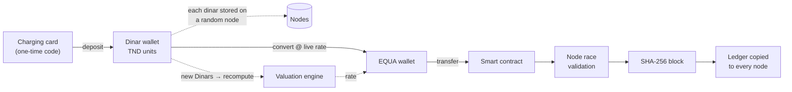
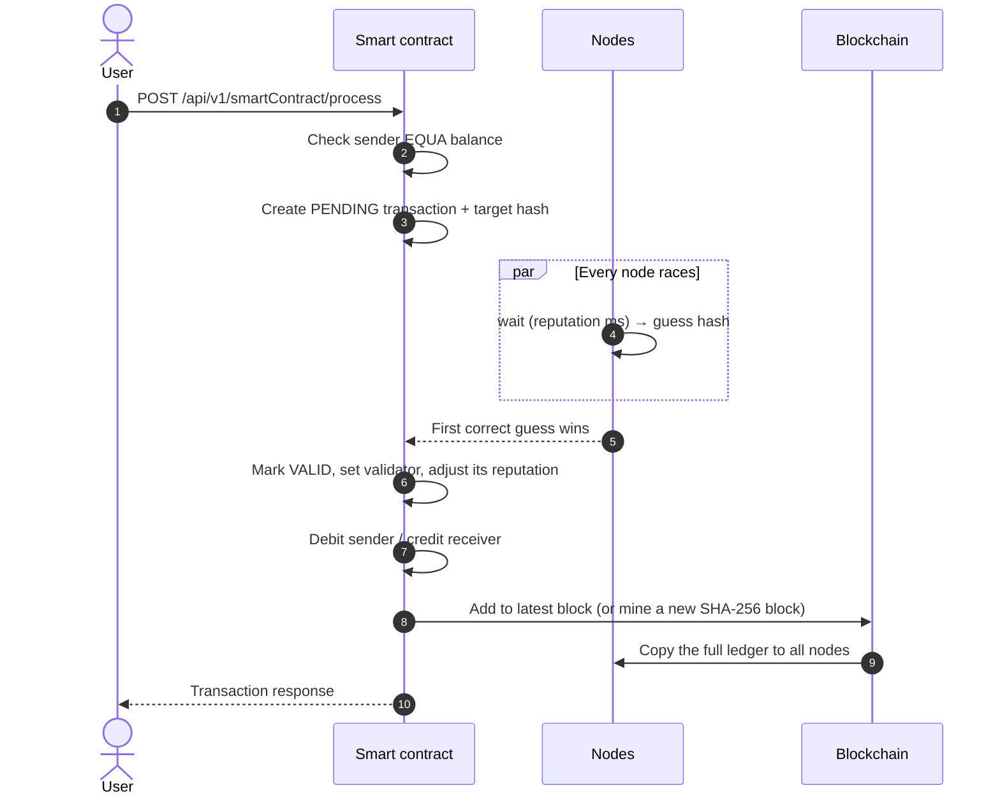
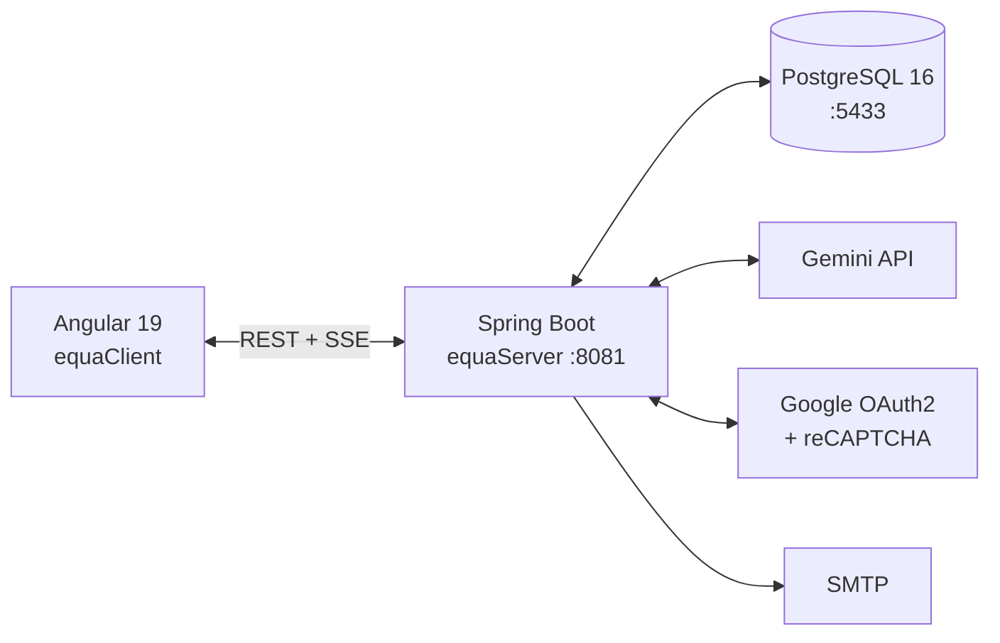

<div align="center">


# EQUA

**A blockchain-backed microfinance platform: top up Dinars with a card, convert them to EQUA, and every EQUA transfer is mined into the chain.**


<br>


<sub>Built for the PIDEV 4th-year engineering program at Esprit School of Engineering (2025–2026)</sub>

</div>

---

## Features

| Feature | What it does |
|---|---|
| **Charging cards** | Redeem a one-time card code to fund your Dinar wallet. Each card can only be used once (`CARD_ALREADY_USED`) |
| **Dinar → EQUA conversion** | Swap TND for EQUA at the live rate set by the valuation engine |
| **Live EQUA rate** | Rate rises as more Dinars get converted, stays between 1 and 1000, and streams over SSE (`/api/v1/rates/stream`) |
| **On-chain transfers** | Every EQUA transfer goes through the smart contract: nodes validate it, it lands in a SHA-256 block, and every node gets a copy of the ledger |
| **Node network** | Nodes store your Dinar units, compete to validate transactions and build up reputation |
| **AI blockchain insights** | Gemini handles chain analysis, health score, validator prediction and chat |
| **Micro-loans & insurance** | Loan requests, credit scoring, automated decisions, amortization schedules, repayments and micro-insurance |
| **Financial market** | Buy and sell assets, track portfolios and price history, with AI market insights |
| **Smart wallets** | Multi-currency transfers, loyalty rewards, achievements, challenges, analytics and fraud checks |
| **Secure accounts** | JWT, Google OAuth2, reCAPTCHA, lockout after failed logins, KYC and roles |
| **Community forum** | Topics and messages, with reporting, moderation and a profanity filter |

---

## How it works

### The EQUA journey



### What happens on a transfer



<details>
<summary><b>Under the hood</b></summary>

| Piece | Behaviour | Source |
|---|---|
| Charging card | `charging_cards` row with `card_code`, `dinar_amount`, `consumed` flag | `ChargingCardService` |
| Deposit | Creates one `TND-<uuid>` Dinar unit per dinar, each on a random node, then recomputes the rate | `DinarWalletService.deposit` |
| Conversion | `EQUA = dinars / rate`, logged as a `Conversion` record | `WalletService.convertDinarsToEqua` |
| Rate | `1 + totalConverted / 10000`, small jitter added, kept between 1 and 1000 | `EquaValuationEngine` |
| Consensus | One thread per node; nodes wait out their reputation score and the first right guess wins | `SmartContract.validateTransaction` |
| Blocks | Each block hashes the previous block's hash with SHA-256 and holds 2–6 transactions. The genesis block's previous hash is `000…0` | `BlockService` |
| Replication | The whole chain is serialised to JSON and saved on every node | `SmartContract.updateNodes` |

</details>

---


---

## Architecture



The project is a **modular monolith**: separate modules in one Spring Boot app, all using the same database.

| Module | Package |
|---|---|
| Blockchain, nodes, Dinar wallet, rate, business | `blockChainManagement` |
| EQUA and multi-currency wallets | `walletManagement` |
| Loans, credit score, insurance | `loanManagement` |
| Assets, trades, portfolio | `financialMarketManagement` |
| Auth, OAuth2, KYC | `userManaement` |
| Forum | `forumManagement` |

Inside each module: `controller → service → repository → entity`, plus `model`/`dto`.

---

## Quick start

**Requires:** Java 21 · Maven 3.8+ · Node 18+ · Docker

```bash
git clone https://github.com/rayenamer/equa && cd equa
docker-compose up -d                                   # PostgreSQL on :5433
cd equaServer && mvn spring-boot:run                   # API on :8081
cd equaClient && npm install && npm start              # (2nd terminal, from repo root) UI on :4200
```

> **Note:** Charging cards have no public creation endpoint. Add rows to the `charging_cards` table before trying a deposit.

---

## Configuration

| File | What goes in it | When it applies |
|---|---|
| `equaServer/.env` | Secrets and DB overrides, loaded by `spring-dotenv` | Every backend run (ask Rayen for the team file) |
| `equaServer/src/main/resources/application.properties` | Port, JPA, mail, forum thresholds, login lockout | Defaults for every run |
| `docker-compose.yml` | Postgres DB/user/password and port | `docker-compose up` |

```bash
# equaServer/.env (example values only)
DB_URL=jdbc:postgresql://127.0.0.1:5433/equadb
DB_USERNAME=equauser
DB_PASSWORD=equapass
GOOGLE_CLIENT_ID=your-client-id.apps.googleusercontent.com
GOOGLE_CLIENT_SECRET=your-client-secret
RECAPTCHA_SECRET_KEY=your-recaptcha-secret
GEMINI_API_KEY=your-gemini-key
OAUTH2_REDIRECT_URI=http://localhost:8081/swagger-ui.html
PASSWORD_RESET_BASE_URL=http://localhost:8081/swagger-ui.html
```

---

## Project structure

```
equa/
├── docker-compose.yml        # PostgreSQL 16 container
├── equaServer/               # Spring Boot API (Java 21)
│   └── src/main/java/com/rayen/
│       ├── blockChainManagement/   # chain, nodes, smart contract, Dinar wallet, rate, AI
│       ├── walletManagement/       # EQUA wallet, conversion, loyalty, fraud
│       ├── loanManagement/         # loans, credit score, insurance
│       ├── financialMarketManagement/ # assets, trades, portfolio
│       ├── userManaement/          # auth, JWT, OAuth2, KYC
│       └── forumManagement/        # forum + moderation
├── equaClient/               # Angular 19 front-end (Chart.js, AG Charts, Three.js)
└── .github/workflows/        # CI: backend + frontend build
```

---

## Development

| You changed… | Do this |
|---|---|
| Java code | Restart `mvn spring-boot:run` in `equaServer` |
| Entities | Restart; `ddl-auto=update` applies the schema changes |
| `.env` / properties | Restart the backend |
| Angular code | Nothing; `ng serve` reloads on its own |
| `docker-compose.yml` | `docker-compose down && docker-compose up -d` |

CI (`.github/workflows/main.yml`) runs `mvn clean verify` against Postgres and builds the frontend on every push. Merge requests are accepted only when the build passes.

---

## Troubleshooting

| Symptom | Fix |
|---|---|
| `Connection refused :5433` | `docker-compose up -d`, then check `docker ps` for `equa-postgres` |
| `CARD_ALREADY_USED` | The card has already been redeemed; use another `card_code` |
| `No nodes available` on deposit | Register a node with `POST /api/v1/nodes` |
| `No blocks found in blockchain` | Create the genesis block with `POST /api/v1/blocks` |
| `INSUFFICIENT CREDIT` | Convert more Dinars to EQUA first |
| AI endpoints fail | Set `GEMINI_API_KEY` in `equaServer/.env` |

---


## Acknowledgment

<div align="center">
<br>
<i>EQUA was more than an academic project; it is a proof of our relentless pursuit of growth, of showing up with discipline and clarity.<br>
We thank our future selves for the glimpses of the vision that keeps us going.</i>
</div>
